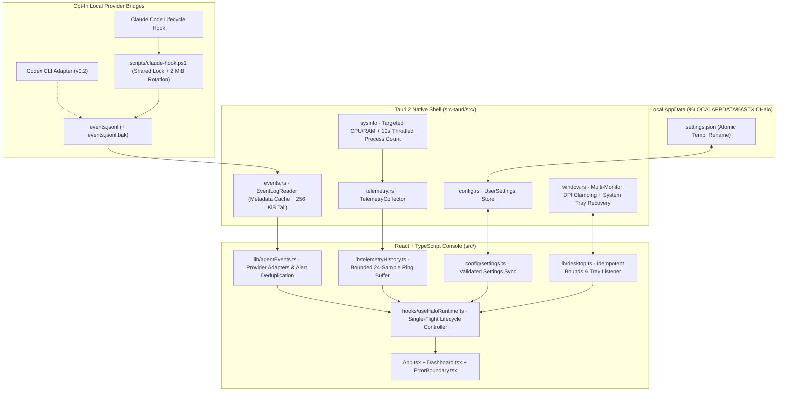

# Architecture — STXIC Halo

## Layered System Map

## Module Responsibilities

### 1. Native Rust Layer (`src-tauri/src/`)
- **[`paths.rs`](file:///d:/Tech/Projects/staxichalo/STXIC_Halo_Full_Project_Package/stxic-halo/src-tauri/src/paths.rs):** Resolves `%LOCALAPPDATA%\STXICHalo` paths (`events.jsonl`, `events.jsonl.bak`, `settings.json`) without touching roaming profiles or external project folders.
- **[`telemetry.rs`](file:///d:/Tech/Projects/staxichalo/STXIC_Halo_Full_Project_Package/stxic-halo/src-tauri/src/telemetry.rs):** Wraps `sysinfo::System` using targeted `RefreshKind` (CPU and memory only on initialization). Samples CPU and physical memory on each poll while throttling Windows process table enumeration (`ProcessRefreshKind::nothing()`) to once every 10 seconds, eliminating kernel handle churn.
- **[`events.rs`](file:///d:/Tech/Projects/staxichalo/STXIC_Halo_Full_Project_Package/stxic-halo/src-tauri/src/events.rs):** Stateful `EventLogReader` that caches `(file_len, modified_ms)`. When `events.jsonl` is unchanged between polls, returns cached events in `O(1)` with zero disk reads or JSON parsing. Automatically rotates logs exceeding 2 MiB and validates schema v1 records.
- **[`config.rs`](file:///d:/Tech/Projects/staxichalo/STXIC_Halo_Full_Project_Package/stxic-halo/src-tauri/src/config.rs):** Schema-versioned `UserSettings` persisted atomically via `settings.json.tmp` rename, with strict numerical clamping (`poll_interval_ms` `1000..=15000`, `top_inset_px` `4..=64`, `stale_minutes` `5..=120`).
- **[`window.rs`](file:///d:/Tech/Projects/staxichalo/STXIC_Halo_Full_Project_Package/stxic-halo/src-tauri/src/window.rs):** Enumerates Windows displays (`MonitorDescriptor`), computes DPI-scaled physical coordinates, clamps window bounds inside the target monitor's visible area, and tightly resizes the frameless window (`460×78` logical px collapsed, `460×604` expanded) so there is no transparent click-blocking overhang.
- **[`lib.rs`](file:///d:/Tech/Projects/staxichalo/STXIC_Halo_Full_Project_Package/stxic-halo/src-tauri/src/lib.rs):** Registers Tauri commands, state containers, and the Windows system tray icon (`Show`, `Expand / Collapse`, `Reset Position to Primary Display`, `Quit`).

### 2. Frontend Layer (`src/`)
- **[`types.ts`](file:///d:/Tech/Projects/staxichalo/STXIC_Halo_Full_Project_Package/stxic-halo/src/types.ts):** Domain models and extensible contracts for future capabilities (`AgentProviderAdapter`, `TokenUsageContract`, `ProofOfWorkVerifierContract`, `NotificationPolicyContract`, `GamingTelemetryContract`).
- **[`config/settings.ts`](file:///d:/Tech/Projects/staxichalo/STXIC_Halo_Full_Project_Package/stxic-halo/src/config/settings.ts):** Client-side settings sanitizer and `localStorage` mirror synchronized with the Tauri Rust config store.
- **[`lib/desktop.ts`](file:///d:/Tech/Projects/staxichalo/STXIC_Halo_Full_Project_Package/stxic-halo/src/lib/desktop.ts):** Safe Tauri IPC bridge with signature-deduplicated `fitIsland` window sizing and system tray event listeners.
- **[`lib/agentEvents.ts`](file:///d:/Tech/Projects/staxichalo/STXIC_Halo_Full_Project_Package/stxic-halo/src/lib/agentEvents.ts):** Provider adapter registry, lifecycle state reducer, session staleness detector (`isSessionStale`), and deterministic alert deduplication (`notificationPolicy`).
- **[`lib/telemetryHistory.ts`](file:///d:/Tech/Projects/staxichalo/STXIC_Halo_Full_Project_Package/stxic-halo/src/lib/telemetryHistory.ts):** Fixed-capacity (24-sample) ring buffer for CPU/RAM trend calculation and the `UNAVAILABLE_GAMING_TELEMETRY` stub.
- **[`hooks/useHaloRuntime.ts`](file:///d:/Tech/Projects/staxichalo/STXIC_Halo_Full_Project_Package/stxic-halo/src/hooks/useHaloRuntime.ts):** Single-flight background polling controller with `document.visibilityState` pause, DPI resize listener, keyboard shortcuts (`Escape` to collapse, `Alt+1..4` to switch tabs), and optional `blur` auto-collapse.
- **[`components/ErrorBoundary.tsx`](file:///d:/Tech/Projects/staxichalo/STXIC_Halo_Full_Project_Package/stxic-halo/src/components/ErrorBoundary.tsx):** Fault-isolating React error boundary that recovers the top-edge capsule without stranding an unclickable overlay on the desktop.

## Data Honesty & Security Principles
- Never merge measurements without provenance. Quota, context window percentage, and token counts are distinct dimensions and render as explicit `null` ("not supplied by hook") when unavailable.
- A `Stop` or `SessionEnd` lifecycle hook indicates end-of-response, never verified task completion (`proof: null`).
- All external strings from `events.jsonl` are length-bounded and rendered as plain text via React (never `dangerouslySetInnerHTML`).
